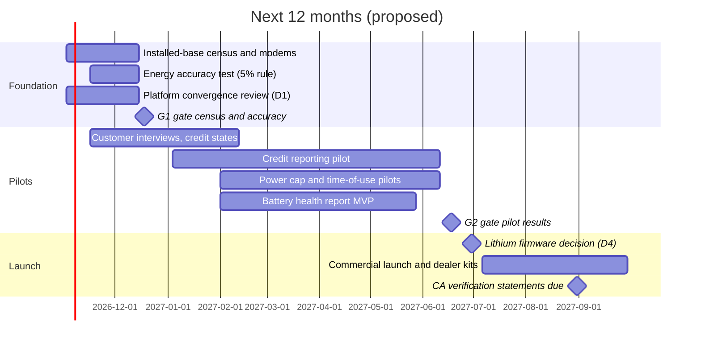

# PosiCharge Roadmap and Business Plan 2027-2030

## Definition

Executive roadmap and business plan for PosiCharge, 2027 to 2030: market context, current position, strategy, short- and long-term roadmap, revenue model, key decisions, risks and KPIs. Vault copy of the shared document of the same name (written 2026-10-17, owner request). Analyst proposal for executive review, not an approved plan.

## Notes

- **Reading rule:** every dollar figure is either a regulator or market value from a source cited in the vault or an analyst assumption listed in "Assumptions" below. No PosiCharge sales, installed-base or pricing data was available. Charts in the shared document are kept here as their data tables.
- **Shared copy:** <https://claude.ai/code/artifact/214a1836-e89d-4032-a694-53d753153d45> (doc; edits there are not synced to this note).
- **Tactical execution** of the top three projects: [[Top Three Installed-Base Projects Tactical Plan]].

### 1. Executive summary

PosiCharge should turn its installed chargers, battery monitors and cloud platforms into a data-and-energy services business in 2027, and use that to keep its chargers on site as fleets move to lithium and truck makers bundle their own chargers. The software alone is a small P&L line; its real job is retention and hardware pull-through.

**Why now**

- **Customers can be paid for data we already hold.** California forklift charging earns about $33 per MWh (trucks under 12,000 lb) to $63 per MWh (heavier trucks) in clean fuel credits; Oregon about $56. Since Q1 2026 California requires metered kWh within 5 percent, which most fleets do not have ([[Forklift Clean Fuel Credit Business Case]]).
- **Truck makers are taking the charger slot.** Hyster-Yale moved in 2025 to 2026 from selling trucks without batteries to supplying its own battery and charger; Jungheinrich, Toyota, KION and Crown already do ([[OEM In-House Lithium Battery and Charger Offers Register]]).
- **Lead-acid still dominates.** About 54 to 70 percent of 2025 forklift batteries were lead-acid (market-report estimate), so care, watering and monitoring stay relevant for years while lithium grows.

**The three moves**

1. **Monetize the installed base (2027):** clean fuel credit reporting, site power and time-of-use control, and a battery health and care-compliance subscription, built on SkyLink, PosiLink and BMID data.
2. **Defend the charger socket (2027 to 2028):** lithium-ready firmware and BMS-directed charging across the installed charger families, and rebate-qualified upgrades.
3. **Become the charger-agnostic energy layer for industrial fleets (2028 to 2030):** one Ampure platform, open site-energy interfaces, connectivity refresh.

**Numbers to plan around:** recurring revenue of about $27,000 to $100,000 a year per 1,000 connected units at the assumed prices and attach rates; customer value of about $330 to $1,250 a year per truck from credits plus $350 to $580 a year per charger from demand-charge control (analyst estimates).

**Decisions needed this quarter:** fund an installed-base census; pick the credit-service model; decide whether PosiLink, SkyLink and Power Designers' PowerCharge.NET converge.

### 2. Market context

| Force | Evidence (as stated by the source) | Implication for PosiCharge |
|---|---|---|
| Chemistry mix | Lead-acid about 54 to 70 percent of 2025 forklift battery share (<https://www.mordorintelligence.com/industry-reports/forklift-battery-market>, market-report estimate). Lithium-ion pack price averaged $108 per kWh in 2025 (<https://about.bnef.com/insights/clean-energy/lithium-ion-battery-pack-prices-fall-to-108-per-kilowatt-hour>). | Lead-acid care and monitoring stay a business through 2030; lithium-ready charging is required to keep sites that convert. |
| OEM bundling | Hyster-Yale "generally sold trucks without" batteries, now supplies battery and charger ([[Document - Hyster-Yale Q4 2025 Earnings Call Transcript (2026-03-04)]]); turnkey lithium from a single source ([[Document - Hyster Lithium-Ion Power Solutions Press Release (2026-05-07)]]); KION lithium at half the price ([[Document - KION Half the Price Lithium-Ion Battery Story (2025-11-27)]]). OEMs still approve third-party power. | The charger slot is contested at every lithium conversion; data services and compatibility are the defense. |
| Clean fuel credits | California metered kWh from Q1 2026, meter within 5 percent, facility owner reports ([[Document - CARB LCFS Guidance 25-01 Forklift Fueling Reporting (2025-10)]]); $72.61 per tonne mid-2026 ([[Document - CARB Weekly LCFS Credit Transfer Activity Reports Page (retrieved 2026-10-17)]]); Oregon more than 3,500 electric forklifts in 2023, over a third of electricity credits ([[Document - Oregon DEQ Forklift Methodology Meeting Deck (2023-05-30)]]). | Charger-side energy data has cash value to the customer. |
| Site energy cost | Demand charges near $9 to $15 per kW (commentary estimate); charger rebates $150 to $550 with efficiency and demand-response gates ([[Document - Mass Save Electric Forklifts and Chargers Rebate Page (2026)]], [[Document - SRP E-Tech Program Factsheet FY27 (2026-05)]]). | Power capping has a measurable payback; connected, efficient chargers qualify for rebates. |
| Regulation | California ZEF binds only government fleets now (phase-out 2028 to 2038); private fleets paused ([[California Forklift Electrification Regulations Register]]). EU battery passport from 2027-02-18 falls on battery makers ([[EU Battery Passport and Battery Regulation Register]]). No source applies NFPA 855 to forklift charging ([[Lithium Forklift Charging Area Fire and Safety Code Register]]). | Plan on credits and energy economics, not mandates. |
| Connectivity | AT&T retiring NB-IoT; leaked T-Mobile LTE plan around 2028, unconfirmed ([[Cellular Network Lifetime and IoT Modem Migration Register]]). | Connectivity refresh is a risk and a sales occasion. |

### 3. Where PosiCharge stands

| Asset | What it already does (public material) | Gap that matters |
|---|---|---|
| [[PosiCharge SkyLink]] | Charger energy, charge-session records, vehicle activity by BMID, remote support, billing support, over-the-air firmware | Energy measuring point and accuracy versus the 5 percent rule; which chargers report |
| [[PosiCharge PosiLink]] | Battery and fleet data, alerts, warranty-compliance tracking; energy management "coming soon" | Boundary with SkyLink; energy management not shipped |
| [[PosiCharge MVS400 and MVS800]] | Group power sharing, site-set time windows, battery-stored equalization schedule | Site energy system interface not stated |
| [[PosiCharge DVS300 Series]] | Fast charging, temperature compensation, time-window current, scheduled equalization | No peer load management stated |
| [[PosiCharge ProCore Edge]] | Lithium charging under BMS control over CAN, opportunity charging | Lithium and BMS charging not shown on DVS, SVS or MVS |
| [[PosiCharge BMID]], [[PosiCharge Battery Rx]], [[PosiCharge PosiGuard]] | Battery identity; voltage, current, temperature, water level; logs; Battery Rx rotation, life and warranty-compliance features, optional cellular | Many BMIDs read over Bluetooth only; connected share unknown |
| [[PosiCharge E-Meter]] | Four-week fleet energy and usage capture over cellular with analysis | One-off assessment tool |

Competitors: at least six makers sell group power management for forklift chargers ([[Forklift Charger Load Management Register]]); at least nine products track equalization or battery health, including Ampure's own [[Power Designers PowerTrac 3]]. PosiCharge's distinctive asset is charger-side energy and battery identity in the same session.

### 4. Strategy

Play where charger data turns into customer cash; win by tying energy delivered to the battery and truck that received it.

1. Material-handling fleets in clean fuel states and provinces (California, Oregon, Washington, New Mexico, British Columbia, Canada federal).
2. Airport GSE fleets in Oregon (EER 3.2) and British Columbia (EER 2.5); California eligibility unconfirmed (C348).
3. Lead-acid fleets anywhere: care compliance where depth of discharge and temperature carry measured life effects ([[Lead-Acid Traction Battery Life Care Methods Register]]).
4. Sites converting to lithium: keep the charger by charging under the pack's BMS.

Not now: EU passport services, NFPA 855 compliance positioning, paid desulfation.

### 5. Short-term roadmap (next 12 months)

Two gates: G1 (2026-12-18) sizes the opportunity from the census and an accuracy test; G2 (2027-06-18) turns pilots into launch.

### 6. Long-term roadmap (2028-2030)

| Phase | Theme | Main items | Exit metric |
|---|---|---|---|
| 2027 | Monetize installed base | Credit reporting; power cap and time-of-use; battery health subscription; right-sizing assessments; rebate-ready HF upgrades | Connected share +15 points |
| 2028 | Defend the charger | Lithium firmware for DVS, SVS, MVS; connectivity refresh (LTE-M); one Ampure platform; site energy interface; revisit filing credits ourselves | Charger kept at 60 percent of lithium conversions |
| 2029-2030 | Energy layer | Data service for any charger; battery-maker data feeds; predictive replacement; airport GSE energy services | 17,000+ connected units |

Gates: G1 Dec 2026 (census, accuracy) · G2 Jun 2027 (pilot results) · G3 Dec 2027 (one platform; new services only on it afterwards) · G4 Dec 2028 (open platform, D7). External dates: EU battery passport Feb 2027; California verification statements Aug 2027; T-Mobile LTE wind-down about 2028 (unconfirmed); California government ZEF phase-out 2028 to 2038.

### 7. Business plan

**Customer value per year (analyst calculation; chart data in the shared doc)**

| Lever | Basis | Low | Central | High |
|---|---|---|---|---|
| Credits, CA truck under 12,000 lb | per truck, 5 to 20 MWh | $166 | $333 | $666 |
| Credits, CA truck 12,000 lb and over | per truck | $313 | $626 | $1,252 |
| Credits, Oregon forklift | per truck | $280 | $560 | $1,120 |
| Demand-charge control | per charger, $9 to $15 per kW | $350 | $465 | $580 |

**PosiCharge recurring revenue per 1,000 connected units (scenario model)**

| Scenario | Credit reporting | Power management | Battery health | Total |
|---|---|---|---|---|
| Low | $10,000 | $10,500 | $6,000 | $26,500 |
| Base | $23,300 | $23,250 | $12,000 | $58,550 |
| High | $41,600 | $40,600 | $18,000 | $100,200 |

Base case needs about 17,000 connected units for $1 million a year. Truck weight class doubles credit value, so tagging sessions to a truck class is the most valuable data field.

| Period | Revenue source | Type |
|---|---|---|
| 2027 | Credit reporting, power management, battery health reports, right-sizing assessments | Recurring services |
| 2027-2028 | Rebate-qualified HF charger replacements (Mass Save $550 per unit), watering retrofits, connectivity kits | Hardware pull-through |
| 2028 | Lithium-ready firmware and BMS charging for installed families | Upgrade and retention |
| 2029-2030 | One Ampure platform, open interfaces, possible charger-agnostic data service | Recurring at scale |

Not modeled: hardware pull-through, lithium upgrade revenue, all costs. Size the investment after G1.

### 8. Key decisions

| # | Decision | Options | Recommendation | Effect on direction | Decide by |
|---|---|---|---|---|---|
| D1 | One data platform or several | (a) converge PosiLink, SkyLink, PowerCharge.NET; (b) shared data layer; (c) keep separate | (a) | (a) one build per service; (b) about double integration work; (c) two or three builds and visible overlap | Dec 2026 |
| D2 | Credit service model | (a) aggregator partner, revenue share; (b) own filing or aggregation; (c) data export only | (a) in 2027, revisit (b) in 2028 | (a) fastest, partner carries verification; (b) higher margin and liability; (c) low cost, no lock-in | Dec 2026 |
| D3 | Census and connectivity | (a) census and fund connectivity; (b) census only; (c) connect new sales only | (a), funding gated on census | Without census no service can be sized | Dec 2026 |
| D4 | Lithium on installed families | (a) firmware for DVS, SVS, MVS; (b) ProCore Edge only; (c) cede to OEMs | (a) top two families, (b) rest | (a) keeps charger at conversion; (c) shrinks to lead-acid and GSE | Q2 2027 |
| D5 | Segment priority | (a) material handling; (b) airport GSE; (c) both | (a) for credits and battery health, (b) for power management | Site density versus site size | Q1 2027 |
| D6 | Pricing model | (a) per-unit subscription; (b) share of value; (c) bundled | (b) credits and power, (a) battery health | Value alignment versus predictability | Q1 2027 |
| D7 | Open or closed platform | (a) charger-agnostic; (b) PosiCharge only | (b) in 2027, evaluate (a) for 2029 | (a) widens market, competes with hardware story | Q4 2028 |

### 9. Risks

| Risk | Effect | Mitigation |
|---|---|---|
| Low connected share | Revenue scales with connected units only | Census (D3); connectivity kit first; Bluetooth harvest during service |
| Charger energy fails 5 percent rule | Credit service needs separate meter | Accuracy test Q4 2026; partner meter |
| Credit price volatility ($39.50 to $196.50 California spot history) | Customer value halves or doubles | Share-of-value pricing; report MWh as well as dollars |
| OEM charger bundling | Fewer charger sales at conversion | Lithium-ready firmware; OEM approvals |
| Aggregators move first | Lower margin | Partner (D2); battery-tagged records |
| Ampure platform overlap | Duplicate cost | Converge (D1) |
| Cellular changes | Units go dark | Modem inventory; 2028 refresh |
| Regulation stalls | Slower electrification | Plan on economics |

### 10. KPIs

| KPI | Proposed 2027 target |
|---|---|
| Connected share | Census baseline, then +15 points |
| Credit energy reported | Pilot sites by Q2, 10 sites by Q4 |
| Data accuracy | Within 5 percent of reference meter |
| Attach rate | 20 percent (base) |
| Recurring revenue per 1,000 connected units | $27k low, $59k base, $100k high |
| Charger retention at lithium conversion | 60 percent |
| Services gross margin | 60 percent or more |

### 11. Assumptions

| Assumption | Value used | Replace with |
|---|---|---|
| Energy per forklift per year | 10 MWh (5 to 20) | SkyLink session data |
| Credit value per MWh | $33.29 CA under 12,000 lb; $62.62 CA heavier; about $56 OR forklift | Quarterly price update |
| Demand-charge saving per charger | $350 to $580 a year | Customer tariffs |
| PosiCharge share of credit value | 15 / 20 / 25 percent | Partner terms |
| Power management price | 20 percent of saving | Pilot willingness to pay |
| Battery health subscription | $60 per battery per year (placeholder) | Price test |
| Attach rates | Credits 20 / 35 / 50; power 15 / 25 / 35; battery health 10 / 20 / 30 percent | Pilot conversion |

Evidence gaps: connected share and geography; charger energy accuracy; site tariffs; aggregator fees; battery replacement prices; which charger families can take lithium firmware (IB-318 to IB-324).

## Open questions

- Should 2027 credit reporting go through an aggregator partner, or should PosiCharge file credits itself from day one (D2)?
- What share of the installed base is connected, and where (IB-318)?

## Aliases

- PosiCharge Business Plan 2027-2030

## Former ids
