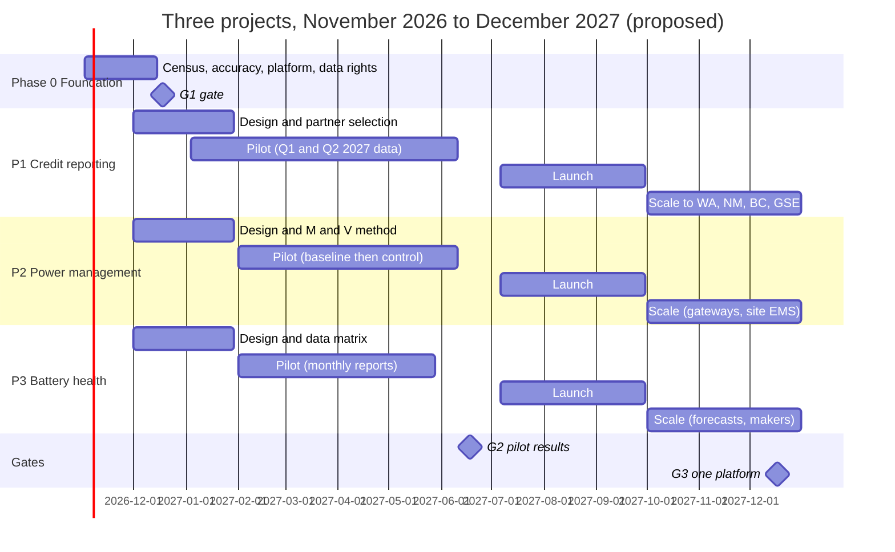
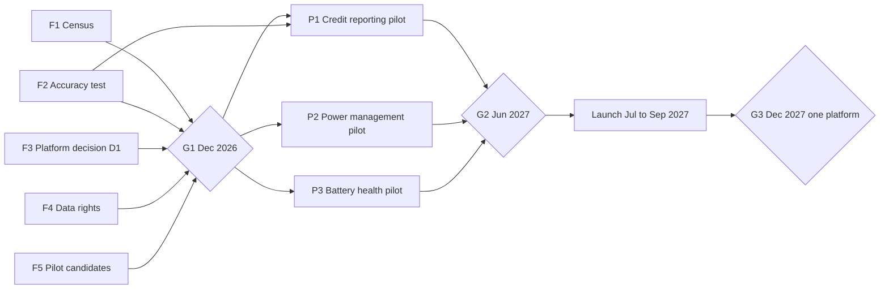

# Top Three Installed-Base Projects Tactical Plan

## Definition

Phase-by-phase execution plan for the three 2027 projects in [[PosiCharge Roadmap and Business Plan 2027-2030]]: P1 clean fuel credit reporting, P2 site power cap and time-of-use charging, P3 battery health and care-compliance subscription. For every phase it states the work, who must give what input, the deliverables, the exit criteria and the effort. Owner request 2026-10-17; analyst proposal, not an approved plan.

## Notes

- **Reading rule:** dates, effort figures, pilot sizes and targets are planning assumptions to confirm at gate G1. Regulatory rules and product capabilities are cited to vault notes. Owners are named by role because no team assignments are in the vault.
- **Why one plan for three projects:** all three read the same data (charge-session energy, battery identity, battery events) from the same installed hardware. Phase 0 builds that shared base once; each project then adds its own logic and report ([[Installed Base Monetization Opportunity Register]], hypothesis MH1).

### Plan at a glance

### Roles

| Role | Accountable for |
|---|---|
| Product lead (one per project) | Scope, pilot customers, gate packages, pricing proposal |
| Power electronics and firmware engineering | Energy measurement, charger control modes, BMID and charger data fields, firmware releases |
| Cloud and data engineering | Data pipeline, reports, platform convergence (SkyLink, PosiLink, PowerCharge.NET) |
| Service and field operations | Census data, site visits, Bluetooth data harvest, install and commissioning |
| Sales and dealer channel | Pilot recruitment, customer interviews, launch packaging |
| Legal and contracts | Data rights, partner contracts, credit-designation and notice language |
| Finance | Revenue model, cost to serve, pricing tests |
| Power Designers liaison | Reuse of PowerCharge.NET, PowerTrac 3 and energy-demand software (IB-322) |

### Phase 0: Foundation (2026-11-02 to 2026-12-18, gate G1)

**Purpose:** size the opportunity and remove the three unknowns every project depends on: how many units are connected and where, whether charger energy data is accurate enough, and which platform carries the services.

| # | Work | Owner | Input needed, and from whom | Deliverable |
|---|---|---|---|---|
| F1 | Installed-base census: model, serial, firmware, site, state or province, last report date, modem type and carrier, BMID generation, battery chemistry | Product ops with Service | Service records and RMA history (Service); SkyLink and PosiLink device registries (Cloud); sales orders and ship-to addresses (Finance); carrier invoices (Procurement) | Census table; connected share by model and geography |
| F2 | Energy accuracy test of SkyLink-reported charge energy against a reference meter at the charger output, two charger families, several load points and at least 10 full charges each | Power electronics and firmware | Description of the firmware energy calculation and measuring point (Firmware); lab time and a reference meter (Test lab) | Accuracy report against the 5 percent rule in CARB Guidance 25-01 ([[Charging Energy Reporting - Provide kWh by Charging Location with Declared Accuracy]]) |
| F3 | Platform review (decision D1): data models, hosting, users, devices and roadmaps of PosiLink, SkyLink and PowerCharge.NET | Cloud architect with Power Designers liaison | Architecture documents and roadmaps from both businesses | Decision memo naming the base platform |
| F4 | Data rights review: who may use charger and battery data under current customer terms; who may generate credits in each program | Legal | Customer contract templates (Sales ops); program rules ([[North American Clean Fuel Programs Register]]) | Data-use position and needed contract changes |
| F5 | Pilot candidate list and interview plan: 12 interviews (about 6 California, 3 Oregon, 2 Washington, 1 New Mexico or BC) | Product leads with Sales | Account list cross-checked against F1 connected sites (Sales) | Shortlist of at least 10 connected candidate sites |

**Questions G1 must answer:** What is the connected share by model and state? Does charger energy meet 5 percent, and at which measuring point? Which platform carries the services? Do current contracts let PosiCharge use the data?

**G1 exit criteria:** census covers the installed units on record; accuracy result signed off (pass, or meter-partner path chosen); D1, D2 and D3 decided; at least 10 candidate pilot sites. **Go or no-go per project.** If connected share is low, the first sale becomes a connectivity kit and P2 and P3 pilots move to connected sites only.

**Effort (assumption):** about 14 person-weeks.

### P1: Clean fuel credit reporting

**Objective:** customers in credit programs collect payment for metered charging energy using PosiCharge data; PosiCharge earns a share. **Value basis:** $33.29 per MWh (California, under 12,000 lb), $62.62 (12,000 lb and over), about $56 (Oregon forklift) ([[Forklift Clean Fuel Credit Business Case]]). **Pilot success:** reports accepted by the partner for 3 or more sites, data within 5 percent, at least one pilot customer converted to paid.

**Requirements already in the vault:** [[California LCFS - Forklift Charging Energy Shall Be Metered]], [[California LCFS - Facility Owner Registers Charging Locations and Reports as First Reporting Entity]], [[California LCFS - Forklift Volumes Are Reported by Lift Capacity Class]], [[California LCFS - Third-Party Verification of Forklift Electricity Data]], [[California LCFS - Rental Forklift Charging Locations Are Registered and Movements Recorded]], [[Charging Energy Reporting - Provide Unadjusted Energy Data at the Output or Forklift Side]], [[Charging Energy Reporting - Tag Charging Records with Forklift Identifier, Lift Capacity Class and Model Year]], [[Charging Energy Reporting - Keep Meter and Energy Records for Verification]], [[Charging Energy Reporting - Publish the Charger Efficiency Basis]], [[Oregon CFP - Forklift Charging Energy Shall Be Directly Metered]], [[Oregon CFP - Credit Generator Registers the Metering Point as Fuel Supply Equipment]], [[Washington CFS - Fleet Owner Is the Fuel Reporting Entity for Forklift Charging Electricity]], [[Washington CFS - Credit Designation Contracts From 2026 Use Prescribed Waiver Language]], [[Washington CFS - Forklift Owner Gives the Operator Annual Written Notice of Credits and Revenue]], [[New Mexico CTFP - Fleets Report Metered Electricity Dispensed to Special Equipment]].

| Phase | Dates | Work | Input needed, and from whom | Deliverables | Exit criteria |
|---|---|---|---|---|---|
| 1 Design | Dec 2026 to Jan 2027 | Partner RFI to credit aggregators (3Degrees, 7Gen, others): fee, programs, verification support, data format, liability. Map the data record to each requirement above. Define how a session is tied to a truck's lift class when batteries move between trucks. Draft monthly site report | Fee and format terms (Partners); customer truck asset lists with capacity and model year (Customers via Sales); BMID-to-truck assignment practice (Service); requirement review (Legal) | Partner shortlist and term sheet; data specification; class-mapping rule; report mock-up | Partner selected; every requirement mapped to a field or a manual step; class rule agreed (a site that cannot tag class reports at the lower class and loses about 47 percent of heavy-truck value) |
| 2 Pilot | Jan to Jun 2027 | Enroll 3 to 5 sites (2 to 3 California, 1 to 2 Oregon). Produce Q1 2027 reports; partner files. Reconcile charger energy with a utility sub-meter or bill. Log hours spent per site | Signed pilot and data-consent agreements (Customers, Legal); registration of charging locations by the facility owner with partner help (Customers, Partner); sub-meter or utility interval data (Customers) | Accepted Q1 reports; reconciliation result; cost-to-serve per site; customer feedback | G2: reports accepted; reconciliation within 5 percent; cost to serve below the PosiCharge share at the base case; at least one customer willing to pay |
| 3 Launch | Jul to Sep 2027 | Price as share of credit value (decision D6); contract templates including Washington waiver and operator notice language; onboarding playbook; dealer training; records kept for verification (California 2026-data statements due 2027-08-31) | Final partner contract (Partner, Legal); price approval (Finance); dealer feedback (Sales) | Commercial offer; contract set; playbook; dealer kit | 10 sites signed by Q4 2027 |
| 4 Scale | Q4 2027 to 2028 | Add Washington, New Mexico, British Columbia and Canada federal; add airport GSE in Oregon and BC (C348); automate reports; revisit filing credits ourselves (D2) | Program-specific formats (Partner); GSE eligibility confirmation (IB-324) | Multi-program reporting; GSE offer | Cost per site falls each quarter; decision on own filing |

**Risks specific to P1:** charger energy fails 5 percent (use a partner meter); batteries swapped between truck classes (default to lower class or tag truck side); verification cost for small reporters (California lets reporters under 6,000 credits defer or forgo, per Guidance 25-01).

**Effort (assumption):** design 8, pilot 16, launch 12 person-weeks; scale about 0.5 FTE per 50 sites.

### P2: Site power cap and time-of-use charging

**Objective:** lower customer demand charges and energy cost with controls already in [[PosiCharge MVS400 and MVS800]] (peer load management, site-set time windows) and [[PosiCharge DVS300 Series]] (time windows), scheduled through PosiLink. **Value basis:** illustration $350 to $580 per charger-year at $9 to $15 per kW ([[Forklift Charging Site Energy Economics and Incentives Register]]). **Pilot success:** measured peak reduction with no truck short of charge at shift start; documented dollars per charger-year.

Functions involved: [[Reduce Charge Current in Site-Set Time Windows]], [[Share Power Between Charging Stations]], [[Balance Charging Power Across Site Capacity]], [[Schedule Charging Around Vehicle Readiness]].

| Phase | Dates | Work | Input needed, and from whom | Deliverables | Exit criteria |
|---|---|---|---|---|---|
| 1 Design | Dec 2026 to Jan 2027 | Confirm which installed models accept a remote power cap and time windows; define control modes (site kW cap, time-of-use windows, priority by state of charge or shift readiness, fallback when communication drops); define measurement and verification from 15-minute utility interval data; build a tariff calculator | Firmware capability by model and version (Firmware, F1 census); 12 months of interval data and tariffs from candidate sites (Customers via Sales); competitor benchmark (Jungheinrich, Linde, Toyota, Crown in [[Forklift Charger Load Management Register]]); Power Designers energy-demand software review (Liaison) | Control-mode specification; M and V method; tariff calculator; list of eligible sites | Specification approved; at least 3 sites with demand charges of $9 per kW or more and compatible chargers |
| 2 Pilot | Feb to Jun 2027 | 2 to 3 sites: 6 to 8 weeks baseline, then 8 to 12 weeks under control; track peak kW, energy shifted, shift-start readiness, operator complaints | Site operations contact and shift schedule (Customers); remote configuration access (Cloud) | Before and after peak and cost; readiness log | G2: peak reduced at every pilot site with zero shift-start shortfalls; saving in dollars per charger-year documented |
| 3 Launch | Jul to Sep 2027 | Price at a share of measured saving or flat per charger (D6); utility rebate and demand-response documentation (network-enabled, efficiency gates); dealer commissioning guide | Price approval (Finance); utility program contacts (Sales) | Offer, commissioning guide, rebate paperwork pack | Attach target set; first paid sites |
| 4 Scale | Q4 2027 to 2028 | Gateway for DVS fleets without peer management; site energy system interface (OpenADR or Modbus, none stated by competitors); airport MVS sites | Protocol choice (Engineering); utility demand-response programs (Sales) | Gateway product; interface specification | Interface decision at G3 |

**Risks specific to P2:** installed firmware cannot take remote settings (field update needed); savings depend on tariffs that utilities change; a missed shift charge destroys trust, so readiness outranks savings in every control mode.

**Effort (assumption):** design 6, pilot 12, launch 8 person-weeks.

### P3: Battery health and care-compliance subscription

**Objective:** a monthly report per battery fleet that flags care-rule exceptions and forecasts replacements, sold to fleet managers, dealers and battery makers. **Evidence base:** depth of discharge and temperature carry measured life effects (100 percent depth of discharge costs about one third of life against 80 percent; ZVEI) ([[Lead-Acid Traction Battery Life Care Methods Register]]). **Pilot success:** exceptions confirmed by service technicians; customers act on the report; price accepted.

**Report rules (configurable per battery maker, because sources disagree, C338 to C346):**

| Rule | Default threshold | Source |
|---|---|---|
| Deep discharge | More than 80 percent of nominal capacity; open-circuit voltage below 1.97 V per cell or density below 1.13 kg/l at 30 C (PzS) | ZVEI 13e |
| Over-temperature | Above 55 C flooded, 45 C valve-regulated; charge start only below 45 C | ZVEI 10e (2011), EnerSys sheet |
| Missed equalization | Maximum amp-hours or days between equalizations, from the battery-stored schedule | [[Battery-Stored Equalization Schedule]] |
| Low electrolyte | Water-level alert from the battery monitor | [[PosiCharge Battery Rx]] |
| Opportunity-charge stress | More than 80 percent of nominal capacity charged per day (flooded) | ZVEI 10e (2011) |
| Replacement forecast | Battery Rx life-expectancy estimate | [[PosiCharge Battery Rx]] |

| Phase | Dates | Work | Input needed, and from whom | Deliverables | Exit criteria |
|---|---|---|---|---|---|
| 1 Design | Dec 2026 to Jan 2027 | Data availability matrix by device (BMID 1, BMID 3, Battery Rx, PosiGuard): which fields are logged and how they reach the cloud (cellular, Bluetooth via PosiConnect, or through the charger at each charge); report specification; warranty criteria from 2 to 3 battery makers | Device data dictionaries (Firmware); harvest options (Service, Cloud); warranty and care criteria (battery makers via Sales: EnerSys, East Penn, Stryten, Exide) | Data matrix; report mock-up; rule set with per-maker settings | Every rule above mapped to a field on at least one device generation; one battery maker willing to review the report |
| 2 Pilot | Feb to May 2027 | 3 fleets, 50 to 150 batteries; four monthly reports; technicians check flagged batteries; test price ($60 per battery per year placeholder against alternatives) | Fleet consent and battery lists (Customers); technician time (Service) | Four report cycles; exception confirmation rate; price test results | G2: most flagged exceptions confirmed by technicians; at least one fleet willing to pay; a dealer willing to resell |
| 3 Launch | Jul to Sep 2027 | Dealer resale package; warranty-support offer to battery makers; replacement-forecast leads routed to dealer sales | Price approval (Finance); dealer agreements (Sales); maker agreements (Business development) | Offer, dealer package, maker pilot agreement | Paid fleets; replacement leads logged |
| 4 Scale | Q4 2027 to 2028 | Predictive replacement models; lithium BMS data on ProCore Edge sites; battery-maker data feeds | Historical data from launch fleets (Cloud); BMS data access (makers) | Forecast model; maker feed specification | Forecast accuracy measured against actual replacements |

**Risks specific to P3:** Bluetooth-only BMIDs give sparse data (harvest at service visits or through the charger); battery makers may see the report as competing with their own monitoring; no subscription price is evidenced yet.

**Effort (assumption):** design 6, pilot 10, launch 8 person-weeks.

### Dependencies and gates

### Effort and budget drivers (assumption)

| Block | Person-weeks |
|---|---|
| Phase 0 Foundation | 14 |
| P1 Credit reporting, phases 1 to 3 | 36 |
| P2 Power management, phases 1 to 3 | 26 |
| P3 Battery health, phases 1 to 3 | 24 |
| Total to launch | 100 (about 2.3 full-time people over 11 months) |

Other cost drivers not sized: reference meter and lab time (F2), partner fees (P1), cellular data plans for added connectivity, field visits for Bluetooth harvest and commissioning, and platform hosting.

### Governance

- Weekly project stand-up per project; monthly product council across the three; gate reviews with the executive team at G1, G2 and G3.
- Each gate package: KPI status ([[PosiCharge Roadmap and Business Plan 2027-2030]] section 10), decisions needed, go or no-go per project, updated revenue model with real data replacing assumptions.

## Open questions

- Who are the named owners for each role?
- Which aggregator partners are acceptable to Legal and Finance (D2)?
- Can the installed MVS and DVS300 firmware take remote power settings today (F1, P2 design)?

## Aliases

- Installed-Base Tactical Plan

## Former ids
